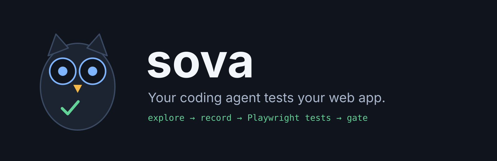

<h1 align="center">sova</h1>

<p align="center">
  <strong>Your coding agent tests your web app.</strong><br />
  It reads the code, walks every screen in a real browser, and leaves a Playwright suite in your repo that nobody wrote by hand.
</p>

<p align="center">
  <a href="#get-started">Get started</a> ·
  <a href="#how-it-works">How it works</a> ·
  <a href="#commands">Commands</a> ·
  <a href="#where-it-stands">Where it stands</a>
</p>

<p align="center">
  <a href="LICENSE"></a>
  
  
  
</p>

<p align="center">
  Built at <a href="https://github.com/sankhya-ai">Sankhya AI Labs</a> on top of <a href="https://github.com/block/trailblaze">Trailblaze</a> by Block.
</p>

---

Our team wrote Playwright tests by hand. It was slow, the tests trailed the product, and the
person writing them was rarely the person who knew what the screen was for.

A coding agent already knows what the screen is for, because it can read the code. sova gives
that agent a browser to drive and a strict gate to pass. The agent explores; sova records what
it did, turns the recording into ordinary `@playwright/test` files, and refuses any test that
is flaky or asserts nothing.

> **You:** Use the sova skill to test this app.
>
> **Your agent:** *maps 21 screens from the router · drives each flow in a browser · saves 11 tests*
>
> **sova check:** `stable 5/5` for every test. **Gate passed.**

## What it does

| | |
|---|---|
| **Finds every screen from the code** | The agent reads your routes and writes them to `sova/screens.yaml`. Screens only an admin sees, or only an error shows, are in the code even when no crawler would reach them. |
| **Drives a real browser** | `sova open`, `sova look`, `sova act`. Each step carries a sentence saying what it is for, and that sentence becomes the step name in the test. |
| **Writes plain Playwright** | One `.spec.ts` per flow, with role and label locators and web-first assertions. No sova runtime in the tests: `npx playwright test` runs them. |
| **Signs in once** | One sign-in flow runs first and every other test starts from its session. Passwords stay in a git-ignored `sova/.env`; the recording holds only the variable's name. |
| **Refuses bad tests** | `sova check` fails a test that is out of date, breaks Playwright practice, or fails even once in five runs with retries off. |
| **Reports like Allure** | `sova report` builds an Allure report of the last run: every step by name, with the screenshot, video and trace of anything that failed. |
| **Tracks coverage by screen** | `sova coverage` fails while any screen has neither a working test nor a written reason to skip it. |
| **Says no instead of guessing** | A step that cannot be replayed exactly is reported as blocked, with the step and the reason. An element no test could find again is refused before it is clicked. |

## Get started

You need Node.js 20 or later and a web app that runs locally.

### Let your coding agent do it

In your web app's repository, tell your agent:

> Install sova from github:sankhya-ai/sova, run its init, then use the sova skill to test this app.

That is the whole setup. The agent runs the two commands below, reads the skill, and starts.

### Or do it yourself

```bash
npm i -D github:sankhya-ai/sova
npx --no-install sova init
```

`init` is safe to re-run. It:

- finds how your app starts and on which port, from `package.json`;
- installs `@playwright/test`, Chromium and the browser driver if they are missing;
- puts the skill where agents look: `.claude/skills/` for Claude Code, `.agents/skills/` for
  Codex, Cursor and others, plus a pointer in `AGENTS.md`;
- writes `sova/config.json`, `sova/screens.yaml` and `sova/playwright.config.mts`.

Then ask, in any session:

| You say | Your agent |
|---|---|
| "Use the sova skill to test this app" | maps the screens, drives each flow, saves the tests, runs the gate |
| "Cover the new billing screen" | adds it to `screens.yaml`, drives its flows, gates them |
| "The settings test broke after my change" | re-drives the flow, or reports the bug if the app is wrong |
| "Run the e2e tests" | `npx --no-install sova run` |

Always type `npx --no-install sova`, not `npx sova`. An unrelated package named plain `sova`
exists on npm, and `npx` would download that one if yours were missing.

## Beyond happy paths (early)

- `sova cases init` adds a checklist to every screen: valid, invalid, empty, boundary, permission, server-error. `sova coverage` counts cases, not just screens.
- Tag each assertion with `[spec: <ref>]` or `[code]` (guessed from the code). `sova assertions` grades flows (smoke vs behavioural) and queues guessed ones for one confirmation: `sova confirm <id> --by <name>`.
- `sova mutate` breaks the app on purpose (`sova/mutations.yaml`) and lists the changes no test noticed.
- Plan and status: [docs/autonomous-qa-plan.md](docs/autonomous-qa-plan.md).

## How it works

```
your code ──► agent maps screens ──► agent drives the browser ──► trail.yaml ──► .spec.ts ──► gate
              sova/screens.yaml      sova open / look / act       sova save      sova emit     sova check
```

A flow, as the agent drives it:

```bash
sova open /login
sova look                                              # what is on screen, a ref per element
sova act type  ref=e9  text=env:APP_TEST_EMAIL    -s "Type the email"
sova act type  ref=e10 text=env:APP_TEST_PASSWORD -s "Type the password"
sova act click ref=e14                            -s "Press Login"
sova act see   ref=e19                            -s "The dashboard is shown"
sova save sign-in
```

What `sova save` writes from that:

```ts
test('sign-in', async ({ page }) => {
  await test.step('Type the email', async () => {
    await page.getByRole('textbox', { name: 'Email address', exact: true }).fill(env('APP_TEST_EMAIL'));
  });
  await test.step('Press Login', async () => {
    await page.getByRole('button', { name: 'Login', exact: true }).click();
  });
  await test.step('The dashboard is shown', async () => {
    await expect(page.getByRole('textbox', { name: 'Ask Tura', exact: true })).toBeVisible();
  });
});
```

What ends up in your repo:

```
trails/<flow>/trail.yaml        the recording; the source of truth
sova/screens.yaml               every screen, and which flows cover it
sova/tests/<flow>.spec.ts       generated; never edited by hand
sova/config.json                base URL, start command, sign-in flow
sova/playwright.config.mts      Playwright config for the suite
sova/.env                       test-account secrets; git-ignored
```

### Signing in

1. Put a **test** account in `sova/.env`: `APP_TEST_EMAIL=...` and `APP_TEST_PASSWORD=...`.
2. The agent drives the sign-in flow once with `text=env:APP_TEST_PASSWORD` and saves it.
3. `sova/config.json` names it:
   `"login": { "trail": "sign-in", "anonymous": ["login-page"] }`.

From then on the sign-in flow runs first and every test starts signed in, except the flows
listed in `anonymous`. In CI, set the same names as environment variables.

### The gate

```bash
npx --no-install sova check      # specs current · practices clean · 5 passes in a row, no retries
npx --no-install sova coverage   # every screen has a working flow, or a reason it is skipped
```

In CI:

```bash
npx --no-install sova emit --check && npx --no-install sova run
```

If your local backend is slow when several tests run at once, set `"workers": 2` and
`"expectTimeout": 15000` in `sova/config.json`.

## Commands

| Command | What it does |
|---|---|
| `sova init` | One-step setup. |
| `sova doctor` | Checks what is installed and prints the fix for what is not. |
| `sova open [url]` | Opens a page in the driven browser. |
| `sova look` | Prints what is on screen, with a ref for each element. |
| `sova act <action> ... -s "<step>"` | Does or asserts one thing. `sova actions` lists them. |
| `sova save <id>` | Saves the flow as `trails/<id>` and generates its test. |
| `sova discard` | Abandons the flow in progress. |
| `sova login` | Signs the driven browser in, without recording, so the next flows start signed in. |
| `sova reset` | Starts over with a clean, signed-out browser. |
| `sova heal <id>` | Replays a flow, repairs small drift, regenerates the test. |
| `sova emit [--check]` | Regenerates every test. `--check` writes nothing and fails on stale tests. |
| `sova lint` | Checks the tests against Playwright practices. |
| `sova check [--repeat n]` | The gate. |
| `sova coverage` | Screens covered, skipped and uncovered. |
| `sova run [-- <playwright args>]` | Runs the suite: `sova run -- --headed`. |
| `sova report [--open]` | Builds an [Allure](https://allurereport.org) report of the last run into `sova/report/`. |

## Where it stands

sova is early. This is what has been shown to work and what has not.

**Shown to work**

- A full run on a real product ([Tura](https://turalearn.com)): 21 screens mapped from the
  router, sign-in with a shared session, and 11 generated tests passing the gate.
- Unit tests and the demo gate run on macOS, Linux and Windows in CI.

**Not there yet**

- **Driving has only been run on macOS, with Claude Code.** The skill is plain text and the
  commands are plain shell, so other agents should work; nobody has tried them yet.
- **The browser driver may need a manual install.** `sova init` installs
  [Trailblaze](https://github.com/block/trailblaze) through Homebrew. Without Homebrew, or if
  Homebrew fails, install it with Trailblaze's own script (it needs Java 17 or later);
  `sova doctor` prints the command.
- **Not on npm yet.** Install from GitHub as shown above.
- **No measure of whether the tests catch bugs.** The gate proves a test is stable and asserts
  something, not that it would fail when the app breaks.
- **Missing assertions:** "is not visible", "is checked", "is disabled".
- **Not supported in recordings:** drag, viewport resize, network assertions, file upload and
  custom scripted tools. Such flows are reported as blocked.
- **`sova heal` is unproven** on a real UI change.
- **Web only.** Trailblaze also drives iOS and Android; sova ignores those recordings.

## Questions

**Do I need to know Trailblaze?** No. sova runs it for you; you and your agent only type `sova`.

**Do I need an API key or a new subscription?** No. The agent you already use does the
exploring. Running the tests uses no model at all.

**Can I run the tests without sova?** Yes: `npx playwright test -c sova/playwright.config.mts`.

**Can I edit a generated test?** No; `sova emit` would overwrite it. Change the flow by
driving it again. Hand-written Playwright tests can live beside the generated ones.

**Will the agent click "Delete account"?** The skill tells it to ask before anything that
cannot be undone or that reaches outside the app: payments, email, deleting data. Give it a
test account and it stays inside that.

**Where do passwords go?** In `sova/.env`, which `sova init` git-ignores. Recordings and tests
contain only the variable's name. The driver's local logs do contain what was typed, so keep
`logs/` out of git too.

## Build from source

```bash
git clone https://github.com/sankhya-ai/sova.git
cd sova
npm install
npm test
```

`examples/demo-app` is a three-screen app with its recordings and the tests sova generates
from them:

```bash
cd examples/demo-app && npm install && npx playwright install chromium
node ../../dist/cli.js emit && node ../../dist/cli.js check
```

## License

[Apache 2.0](LICENSE), the same licence as [Trailblaze](https://github.com/block/trailblaze),
which sova depends on to drive and record the browser.
